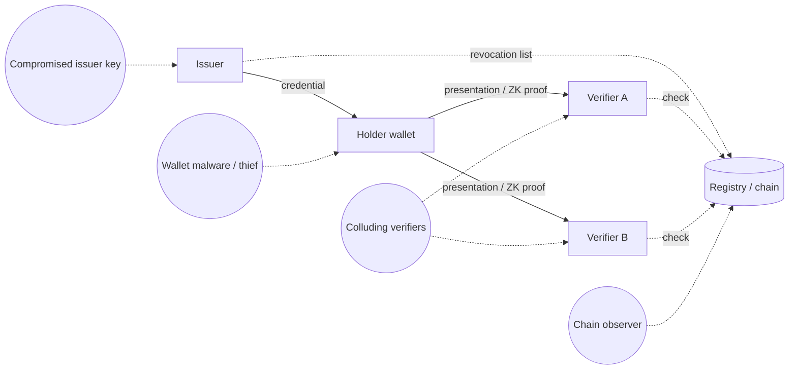

# Identity Mechanisms and Threat Model

Decentralised identity systems promise that users can prove facts about themselves ("over 18", "a resident of country X", "a unique human", "holder of a KYC check") without a central identity provider watching every login, and often without revealing who they are. This book stress-tests those promises. Many systems hold up cryptographically and fail through key management, issuer trust, linkability or simple contract bugs.

## The roles

Every credential system has the same three roles, plus infrastructure:

| Role | Does | Trusted for |
|---|---|---|
| Issuer | Checks facts (passport, KYC, membership) and signs a credential | Telling the truth about the subject, protecting its signing key, revoking when needed |
| Holder | Stores credentials in a wallet and presents proofs | Keeping keys and credentials private |
| Verifier | Checks presentations and grants access or rewards | Checking issuer keys, revocation, freshness and binding |
| Registry / ledger | Publishes DID documents, issuer keys, revocation lists, group roots | Availability and integrity |

The ENISA report *Privacy and Data Protection by Design* (Danezis et al., 2014) describes why this shape differs from federated login. In federated identity, the identity provider sees every service a user visits and "effectively has the keys" to any resource it vouches for. In attribute-based credentials, "the user [is] central to all transactions": the issuer signs once, and the holder later shows only what is needed.

## Building blocks covered in this book

| Building block | Standard / project (check current status) | Chapter |
|---|---|---|
| Decentralised identifiers (DIDs) | W3C DID Core 1.0 (Recommendation, 2022) | 2 |
| Verifiable credentials | W3C Verifiable Credentials Data Model 2.0 (Recommendation, May 2025) | 2, 3 |
| Salted-hash selective disclosure | IETF SD-JWT, RFC 9901 (November 2025) | 3 |
| Signature-based selective disclosure | BBS signatures (IRTF CFRG Internet-Draft) | 3 |
| Anonymous group membership | Semaphore (V4) | 4 |
| Document-based ZK proofs | ZK passport/ID projects (ZKPassport, Self, Rarimo, Anon Aadhaar and others) | 4 |
| Revocation and status | Status lists, accumulators, Merkle exclusion | 5 |

## The privacy properties that matter

ENISA's report lists the properties attribute-based credentials must satisfy. They make a good checklist for any system:

- **Unforgeability.** "Only issuers can create valid credentials."
- **Unlinkability.** No one, including the issuer, can link a presentation to its issuance, or two presentations to each other. The report's example: if you use the same credential a hundred times at one service, the service sees "a hundred different customers".
- **Non-transferability.** A credential issued to one holder cannot be used by another, and holders cannot pool credentials.
- **Revocability.** Revoked credentials stop working. The report notes that revocation "badly interacts" with unlinkability.
- **Identity escrow (optional).** A trusted inspector can de-anonymise under defined conditions.

Real systems rarely get all five. Most marketing says "private" when the system only offers *selective disclosure* (fewer attributes shown) but not *unlinkability* (presentations can still be correlated). A large part of a review is finding out which properties actually hold.

## Threat model

| Adversary | Goal | Typical weakness |
|---|---|---|
| Colluding verifiers | Link a holder's activity across services | Reused identifiers, signatures or digests; stable nullifiers across scopes |
| Issuer | Track where credentials are used | Online status checks; per-credential revocation indices |
| Chain observer | Deanonymise on-chain proofs | Timing, gas payer, small anonymity sets, public attributes |
| Credential thief | Use someone else's credential | Weak holder binding; transferable tokens |
| Sybil attacker | Get many identities | Multiple documents per person; weak uniqueness; redeployments resetting nullifier state |
| Issuer-key attacker | Mint fake credentials | Key compromise, slow revocation, no key rotation story |
| Wallet attacker | Steal keys or trick users into over-sharing | Phishing presentation requests, malicious verifier requests |

## Correlation is the default

Unless designed otherwise, credential systems are linkable. Signatures, salts, digests, credential IDs, DIDs, status-list indices and nullifiers are all stable values that verifiers can match. Danezis et al. name two strategies for unlinkability: use each credential only once (fresh credential per presentation), or use schemes whose presentations are randomised zero-knowledge proofs. Everything else leaks a correlation handle. Chapter 6 collects correlation attacks in one place.

See **privacy-protocol-security** for related on-chain privacy issues and **zk-circuit-security** for circuit bugs.

## Worked example

*Execution status: Not executed in this book's CI; desk exercise.*

Map a real system's privacy claims against the five ENISA properties:

1. Pick one credential system you can study (a ZK passport app, a KYC credential, a proof-of-personhood scheme). Read its docs.
2. List every value a verifier receives in a presentation: identifiers, signatures, digests, proofs, public inputs, nullifiers.
3. For each value, mark whether it is the same across presentations to different verifiers (correlation handle) or fresh each time.
4. For each ENISA property, write "holds", "partly" or "does not hold", with the evidence from step 2.
5. Compare your table with the project's marketing claims and note any gap.

## Common pitfalls

- Equating selective disclosure with unlinkability.
- Ignoring the issuer as an adversary that can track usage through revocation checks.
- Assuming on-chain ZK proofs are anonymous when the gas payer is the user's main wallet.
- Forgetting that holder binding, not the cryptography, is what stops credential sharing.
- Treating standards status as a security guarantee; standards fix formats, not deployments.

## Exercises

1. Complete the property table for two systems and compare.
2. Draw the data flows of a presentation for a system of your choice and mark every party that can log it.
3. Write three questions you would ask an issuer about key protection and revocation before trusting its credentials.

## Further reading

- G. Danezis et al., *Privacy and Data Protection by Design – from policy to engineering* (ENISA, 2014), Section 4.2 on attribute-based credentials.
- W3C DID Core 1.0: <https://www.w3.org/TR/did-core/>
- W3C Verifiable Credentials Data Model 2.0: <https://www.w3.org/TR/vc-data-model-2.0/>
- See **passkeys-webauthn-web3** for wallet authentication.
